# bouncer

**PEW vs BOUNCER** is a one-on-one Street Fighter-style brawl for the GitHub
Universe 2026 badge (Tufty 2350 derivative, 160x120 logical screen). Pew, the
cat-octopus from `pew.png`, ties on a red headband and boxing gloves to get
past a beefed-up bouncer guarding the VIP door in the pink "Partner of the
Year" varsity jacket. Jab, cross, kick and uppercut him, hop his stomps,
block his LAST CALL charge, and when your bar is full, let loose the
**OCTO-RUSH**. Win two rounds and you're on the list: the jacket is yours.

To play it on your own badge, see
[Install on your badge](#install-on-your-badge).

## What it looks like

These are captures from the badge simulator (`tools/simulate.mjs`). The
badge's 160x120 screen is shown at 2x in the animations and 3x in the stills.

<p align="center">
  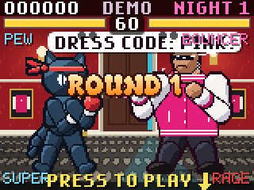
  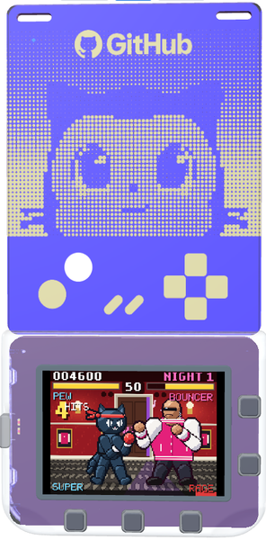
</p>

<p align="center">
  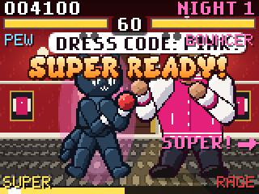
  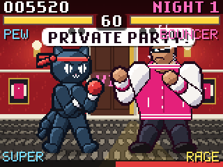
</p>

| | | |
| :---: | :---: | :---: |
| 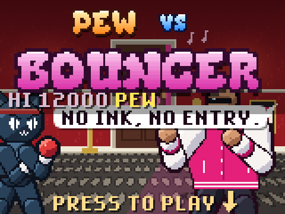 | 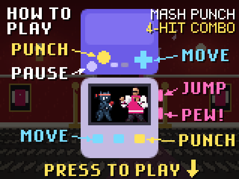 | 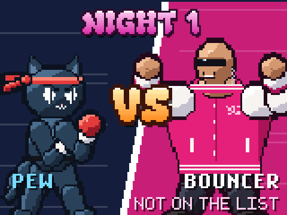 |
| **Title**: the arrow points at the real SELECT button | **How to play**: arrows to every control, plus tips | **Versus** splash before every night |
| 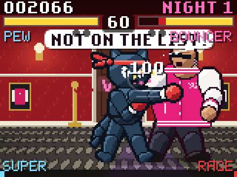 | 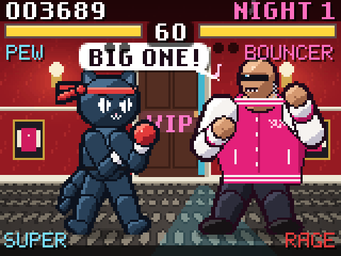 | 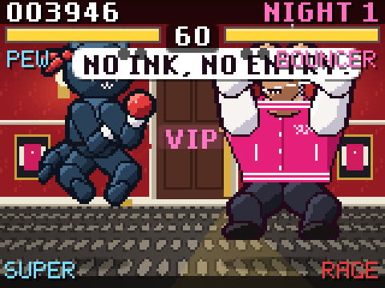 |
| **Fight**: mash PUNCH for jab, cross, kick, uppercut | **Haymaker**: a slow telegraph, block it | **Ground pound**: jump the shockwave |
| 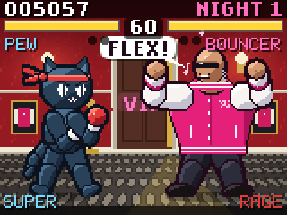 | 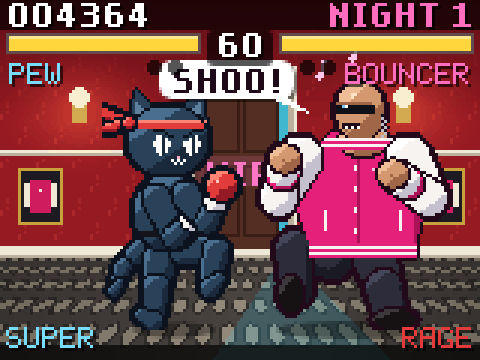 | 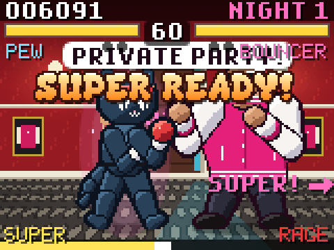 |
| **Snap barrage**: flexing pops his buttons | **His kick**: knee up, then the boot | **SUPER READY!**: Pew glows, the arrow points at DOWN |
| 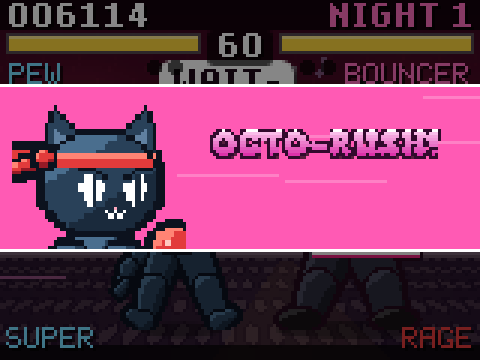 | 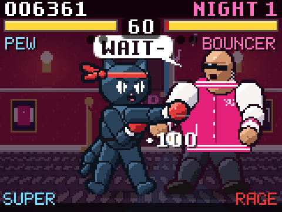 | 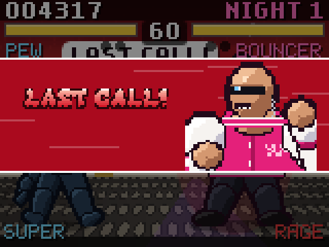 |
| **OCTO-RUSH** cut-in | Eight hits, then an uppercut | **LAST CALL**: his super, when RAGE is full |
| 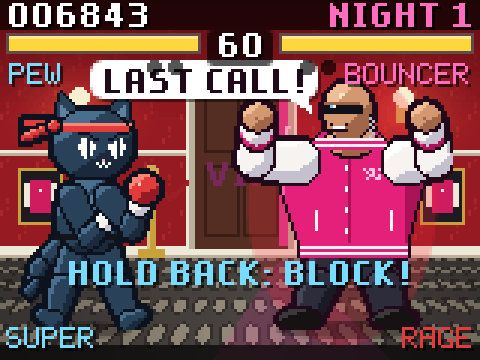 | 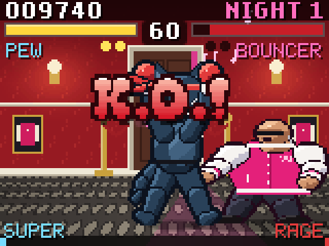 | 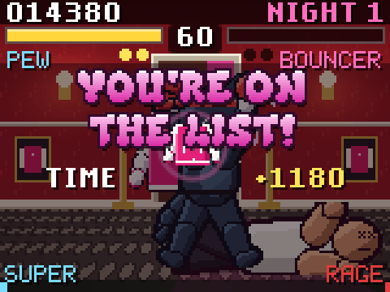 |
| **Hold back** to block the charge | **K.O.!** in slow motion | **You're on the list**: the jacket flies to Pew |
| 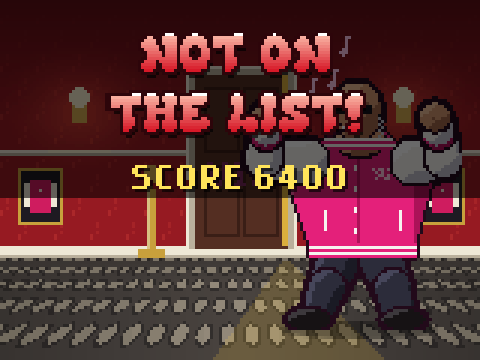 | 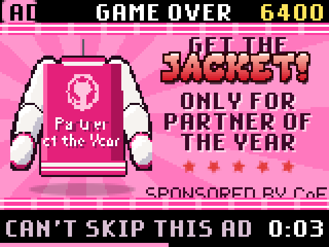 | 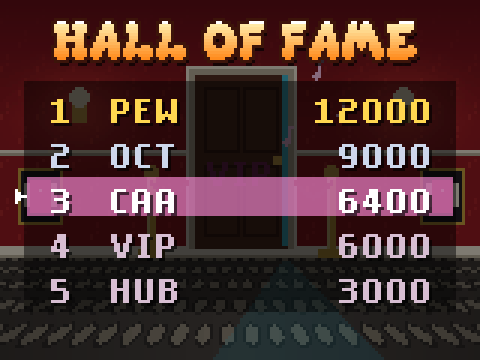 |
| **Lose** and Pew gets tossed down the hallway | **Then** the 6-second jacket ad | **Hall of Fame**, after the name entry |

<p align="center">
  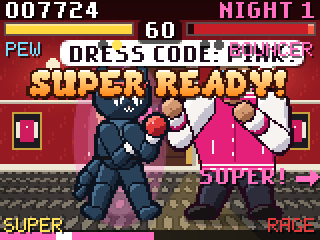
  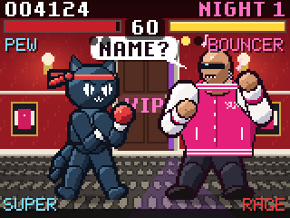
</p>

## Install on your badge

The game is one folder, `badge/apps/bouncer`. Copy it into the badge's `apps`
folder and it shows up in the badge menu. No firmware update, Wi-Fi or extra
hardware is needed.

You need:

- a GitHub Universe 2026 badge;
- a USB-C cable that carries data (with a charge-only cable the badge's drive
  never appears);
- this repository: `git clone https://github.com/martijnvankempen/bouncer.git`,
  or **Code > Download ZIP** on GitHub and unzip it.

### Copy it by hand

1. Connect the badge to your computer.
2. Put the badge in USB Disk Mode: quickly double-tap its RESET button, or open
   the **Mass Storage** app from the badge menu. After a few seconds a drive
   called **BADGER** appears.
3. Open BADGER. It has an `apps` folder (on some badges `system/apps`).
4. Copy the `badge/apps/bouncer` folder from this repository into that `apps`
   folder. Copy the folder itself, so you end up with
   `BADGER/apps/bouncer/__init__.py`.
5. Eject BADGER like a USB stick and wait for the drive to disappear. The
   badge restarts into the menu; press RESET if it doesn't. On Windows, "An
   error occurred while ejecting 'BADGER'" is harmless: the badge restarts as
   soon as it gets the request, after the files are written.
6. In the menu, move to the **Bouncer** tile with the buttons and press
   SELECT. It comes after the badge's own apps.

### Or use the badger/home scripts

[badger/home](https://github.com/badger/home) has scripts that switch the
badge to USB Disk Mode, copy the app and eject the drive for you. They need
Python 3 and `mpremote`. Run them from the root of this repository.

macOS or Linux:

```sh
git clone --depth 1 https://github.com/badger/home ~/src/badger-home
python3 -m pip install mpremote
scripts=~/src/badger-home/.github/skills/hyb26-skill/scripts

python3 $scripts/badge_serial.py disk-mode            # reboots into USB Disk Mode
python3 $scripts/deploy_app.py badge/apps/bouncer     # lists what it would copy
python3 $scripts/deploy_app.py badge/apps/bouncer --write
python3 $scripts/badge_serial.py eject
```

Windows (PowerShell, not WSL: WSL doesn't see the badge's USB port or the
BADGER drive):

```powershell
git clone --depth 1 https://github.com/badger/home $HOME\src\badger-home
python -m pip install mpremote
$scripts = "$HOME\src\badger-home\.github\skills\hyb26-skill\scripts"

python $scripts\badge_serial.py disk-mode
python $scripts\deploy_app.py badge\apps\bouncer
python $scripts\deploy_app.py badge\apps\bouncer --write
python $scripts\badge_serial.py eject
```

- `deploy_app.py` finds BADGER by itself; if it doesn't, add `--mount` with
  the drive, for example `--mount E:\` or `--mount /Volumes/BADGER`.
- If `disk-mode` fails on your badge's firmware, double-tap RESET instead.
- If pip refuses to install `mpremote` ("externally managed"), use
  `pipx install mpremote`.

### Update to a new version

Get the new version (`git pull`, or download the ZIP again) and copy it
again. By hand, delete `BADGER/apps/bouncer` first. With the script, add
`--replace`; it keeps the old version in `BADGER/.badge-app-backups`:

```sh
python3 $scripts/deploy_app.py badge/apps/bouncer --write --replace
```

The Hall of Fame, best score and last initials live outside the app folder,
in `/state/bouncer.json`, so updates keep them.

### Pew on the menu tile

The menu on badges from the event shows a default icon for apps that don't
come with the badge. To show the app's `icon.png` (Pew in his headband) on the
tile instead, patch the menu once per badge, in USB Disk Mode:

```sh
python3 $scripts/badge_serial.py info               # "menu icon.png support: yes/no"
python3 $scripts/patch_menu_icons.py                # preview
python3 $scripts/patch_menu_icons.py --write
python3 $scripts/badge_serial.py eject
```

The patch keeps the original menu in `BADGER/.badge-app-backups`. The game
works the same without it.

### Remove it

In USB Disk Mode, delete `BADGER/apps/bouncer` and eject. The scores stay in
`/state/bouncer.json`, which isn't on the BADGER drive. To clear them, for
example to start a fresh Hall of Fame on an event day, run this with the
port from `badge_serial.py port` (such as `COM5` or `/dev/ttyACM0`) and press
RESET afterwards:

```sh
mpremote connect PORT exec "import os; os.remove('/state/bouncer.json')"
```

### If something goes wrong

| Problem | What to do |
| --- | --- |
| No BADGER drive | Use a data cable. Double-tap RESET faster, or open the Mass Storage app. |
| A drive called RP2350 appears | That's the firmware bootloader, not the badge's storage. Don't copy anything there; press RESET once and try again. |
| Bouncer isn't in the menu | Check that `BADGER/apps/bouncer/__init__.py` exists (not `apps/bouncer/bouncer/...` or `apps/badge/...`), then press RESET. |
| The tile has a default icon | See [Pew on the menu tile](#pew-on-the-menu-tile). |
| The badge doesn't restart after ejecting | Press RESET. |
| The game stops with an error | Run `mpremote connect PORT resume repl`, start the game from the menu and read the error; Ctrl-] exits. |

## How to play

Each night is a best-of-three fight against the bouncer, 60 seconds a round.
Knock him out (or have more health left when the clock runs out) in two
rounds and you're on the list: the jacket is yours and the next night's
bouncer is bigger. Lose two rounds and you get thrown out.

### The badge's controls

Hold the badge as it hangs on the lanyard: the purple touch card on top and
the screen below it.

- **Touch pad** (purple card): a d-pad on the right; on the left a big round
  SELECT pad and a smaller round BACK pad; in the middle two small pills,
  MENU and HOME.
- **Buttons**: LEFT, RIGHT and SELECT under the screen; UP and DOWN on the
  right edge.

| Control | Simulator key | Title screen | How to play | Fighting | Paused | Name entry |
| --- | --- | --- | --- | --- | --- | --- |
| LEFT / RIGHT (buttons or touch d-pad) | Arrow Left / Right, A / D | | | Walk back / forward; hold back to block | | Previous / next letter |
| SELECT (button or big touch pad) | Space or Enter, or J | How to play | Fight! | PUNCH (mash or hold to chain) | Resume | Next letter; on the last one, save |
| UP (right edge, or touch d-pad) | Arrow Up, W | | | Jump; PUNCH in the air is a dive kick | | Change letter |
| DOWN (right edge, or touch d-pad) | Arrow Down, S | | | PEW! (star shot); with a full bar, OCTO-RUSH | | Change letter |
| BACK (small touch pad) | K | | Back to title | Pause | Quit to title | Previous letter |
| MENU (touch pill) | U | | | Pause | | |
| HOME (touch pill) | Esc | Back to the badge menu | Back to the badge menu | Back to the badge menu | Back to the badge menu | Back to the badge menu |

Pew always faces right, at the bouncer, so "back" is LEFT and "forward" is
RIGHT. No button does anything while Pew is being thrown out or during the ad.

You don't need to know the button names: whenever the game wants SELECT
("PRESS TO PLAY", "NEXT"), a bouncing arrow at the bottom edge of the screen
points straight down at the SELECT button under it. When your SUPER is ready,
"SUPER!" and an arrow at the right edge point at DOWN.

### How to play card

Pressing SELECT on the title shows a HOW TO PLAY card before the fight: a
drawing of the badge with labelled arrows pointing at each control (PUNCH,
MOVE, JUMP, PEW!, PAUSE), colour-coded like the controls themselves. One arrow
at a time turns white and its control blinks, and tips cycle in the corner
("MASH PUNCH: 4-HIT COMBO", "FORWARD + PUNCH = KICK", "HE GLOWS RED? BLOCK!").
It stays up until you press SELECT; BACK goes back to the title.

### Attract mode

Leave the title screen alone for 9 seconds and the badge plays itself: an
autopilot fights the bouncer for up to 30 seconds (blocking, jumping, comboing
and firing its OCTO-RUSH), then the Hall of Fame and the HOW TO PLAY card are
shown and it goes back to the title. SELECT starts a real game from the demo,
the Hall of Fame or the card; any other button goes to the title.

### Pew's moves

| Move | Input | Damage | Notes |
| --- | --- | --- | --- |
| Jab | PUNCH | 2 | Fast. Keep pressing (or hold) PUNCH to chain |
| Cross | PUNCH after the jab | 3 | |
| Kick | PUNCH after the cross, or **forward + PUNCH** | 5 | A tentacle roundhouse at belt height; "KICK!" |
| Uppercut | PUNCH after the kick | 7 | Ends the chain with a big knockback; "UPPERCUT!" |
| Dive kick | UP, then PUNCH in the air | 7 | Comes down at an angle and bounces off |
| PEW! | DOWN | 6 | A spinning star shot from the gloves, once every 0.9 s |
| Block | Hold LEFT (back) | | Blocks punches, kicks and snaps; the haymaker and LAST CALL still chip a little |
| **OCTO-RUSH** | DOWN with a full SUPER bar | 48 | Super: a cut-in, a dash and an unblockable 8-hit flurry ending in an uppercut |

Every hit you land fills the SUPER bar at the bottom left; so do blocks and
getting hit. When it's full Pew glows pink, "SUPER READY!" slams onto the
screen and the bar flashes. The OCTO-RUSH freezes the fight for a cut-in with
Pew's face on a pink band, then Pew dashes in and cycles jabs, crosses and
kicks before the final uppercut.

### The bouncer's moves

| Move | Tell | What to do |
| --- | --- | --- |
| Jab | Pulls his fist back | Block, or hit him first |
| Front kick | Knee comes up ("SHOO!") | Block or back off |
| Haymaker | Long wind-up, arm way back ("BIG ONE!") | Block it; from night 2 he can't be staggered during the wind-up |
| Belly bump | Leans in | Block; he ignores hits while he lunges |
| Ground pound | Fists up, then the floor | Jump the shockwave; blocking doesn't help |
| Snap barrage | Flexes ("SNAP SNAP SNAP!") and his jacket buttons fly | Block, or jump the low ones |
| **LAST CALL** | Super, when his RAGE bar is full | Hold back to block the charge |

His RAGE bar at the bottom right fills slowly by itself and quickly when you
hit him. When it's full he goes into **LAST CALL**, even straight out of your
combo: the fight freezes for a cut-in with his face on a red band, he flexes
glowing red while nothing staggers him ("HOLD BACK: BLOCK!" flashes), then
shoulder-charges across the hallway. Taken, it's a quarter of Pew's health;
blocked, it's a scrape and a big boost to your own SUPER bar ("NICE BLOCK!").

He also blocks when you keep swinging (after a full 4-hit chain, so reset and
go again), taunts, talks a lot and can't be walked through. Each night he
starts with 40 more health, is a little bigger and attacks more often; his
snap barrage unlocks on night 2, or earlier when he's below half health.

### Scoring

| Hit | Points |
| --- | --- |
| Jab / cross / kick / uppercut | 100 / 150 / 200 / 300 |
| Dive kick | 200 |
| PEW! star | 200 |
| OCTO-RUSH | 100 a hit, 1000 for the final uppercut |
| K.O. | 1000 x the night |

Hits within 0.9 s of each other make a combo; 3 or more hits add 25 x hits²
when the combo ends ("7 HITS +1225"). Winning a night adds the time left
(20 a second), your health (10 a point) and 2000 for a PERFECT final round
without taking damage.

### Winning and losing

- **K.O.!** Whoever drops first is knocked out in slow motion. If the clock
  runs out, "TIME!" and whoever has more health left (as a share) wins.
- **You're on the list.** The bonuses count up, the bouncer's jacket flies
  over and lands on Pew's shoulders, and the VIP door swings open. Next
  night, Pew walks in wearing it (it flaps behind him like a champ's robe).
- **Not on the list.** The bouncer picks Pew up and throws him down the
  hallway ("NICE TRY, CALAMARI."), then "NOT ON THE LIST!" with your score.

### The ad

Then a 6-second ad plays and no button can skip it: the jacket spins on its
hanger over a pink sunburst, "GET THE JACKET! ONLY FOR PARTNER OF THE YEAR",
five stars, "SPONSORED BY CoE". The bottom bar counts down while the case
LEDs pulse. After the ad you go to the name entry if your score made the Hall
of Fame, otherwise back to the title screen. The demo never shows it.

### Hall of Fame

The five best scores are kept on the badge with three-letter initials. It
starts with made-up scores to beat, arcade style. When your score makes the
table, the name entry follows the ad, and it remembers the last initials you
used. The table is saved straight away and shown with your row highlighted.

### Screen and lights

- Top bar: your score and the night; health bars with a red trail that
  slides down after each hit, the round timer between them, and dots for
  rounds won under each name.
- Bottom edge: Pew's SUPER bar (left, cyan, flashing gold and pink when full)
  and the bouncer's RAGE bar (right, red, flashing gold when it's nearly
  full).
- Hits freeze the action for a moment and shake the screen; supers dim the
  screen for a cut-in. The case LEDs flash on hits, chase around the badge
  during supers and K.O.s and breathe slowly in attract mode.

### Saved on the badge

The Hall of Fame, your last initials and the best score are kept between
games and after a reset. Scores are only saved when you lose: quitting to
the title from the pause screen, or pressing HOME, doesn't save them.

## Layout

| Path | What |
| --- | --- |
| `badge/apps/bouncer/__init__.py` | App setup, screens (title, how to play, attract demo, versus, fight, pause, thrown out, ad, name entry, Hall of Fame), rounds and nights, hit detection, combos, both supers and their cut-ins, HUD, saved data |
| `badge/apps/bouncer/pew.py` | Pew: walking, blocking, jumping, the jab-cross-kick-uppercut chain, dive kick, star shots, SUPER bar, poses |
| `badge/apps/bouncer/bouncer.py` | The bouncer: AI, moves and their hitboxes, shockwaves, snaps, RAGE and LAST CALL, speech, poses |
| `badge/apps/bouncer/fx.py` | The hallway (door, lamps, carpet), particles, rings, score popups, screen flash and shake, case LEDs |
| `badge/apps/bouncer/controls.py` | Reads the buttons and touch pad into one input per frame |
| `badge/apps/bouncer/assets/`, `icon.png` | Generated images: both fighters' sprite sheets, K.O. poses, cut-in faces, the jacket front and back, the hallway, the logo |
| `tools/make_assets.py` | Builds the images (needs Pillow): the logo from `pew.png`; the fighters, jacket and hallway as pixel art |
| `tools/simulate.mjs` | Runs the app in the badge simulator in a browser (needs Node and a badger/home clone) |
| `tools/capture.py` | Stages each scene in the simulator and saves the README's stills and GIFs |
| `docs/screenshots/` | The README's screenshots and animations, captured in the simulator |

The app uses the 2026 runtime globals (`badge`, `screen`, `image`, ...), not
the 2025 `badgeware` API.

## Regenerate the images

```sh
python3 -m venv ~/.venvs/bouncer && ~/.venvs/bouncer/bin/pip install pillow
~/.venvs/bouncer/bin/python tools/make_assets.py
```

Both fighters are drawn from posed skeletons in `make_assets.py`: each frame
is a list of joint positions, and the script paints the limbs, gloves, jacket
and faces over them. Pew's frames are 64x84 and the bouncer's 78x84, so they
stand the same height. If you change a frame's order or size, update the frame
constants at the top of `pew.py` or `bouncer.py`. The jacket's pink, white
sleeves and "Partner of the Year" print are taken from the two jacket photos
and redrawn as pixel art; the photos themselves aren't in the repository.

## Check and run

The checks and deployment tools live in
[badger/home](https://github.com/badger/home). With a clone at
`~/src/badger-home`:

```sh
scripts=~/src/badger-home/.github/skills/hyb26-skill/scripts
python3 $scripts/validate_app.py badge/apps/bouncer --target emulator
python3 ~/src/badger-home/.github/scripts/validate_app_readmes.py badge/apps
```

To try it without a badge, start the simulator and open the printed URL
(the keys are in the controls table above):

```sh
node tools/simulate.mjs --home ~/src/badger-home
```

It serves the Badge Simulator page from the badger/home clone, runs
`badge/apps/bouncer` in it and accepts scripted presses, screenshots, code
and recordings (`/ctl/press`, `/ctl/screenshot`, `/ctl/exec`,
`/ctl/record-start`; see the top of the script). With the simulator open in a
browser, this recaptures every screenshot and GIF in this README:

```sh
~/.venvs/bouncer/bin/python tools/capture.py
```

The case LEDs need real hardware. To put it on a real badge, see
[Install on your badge](#install-on-your-badge).
